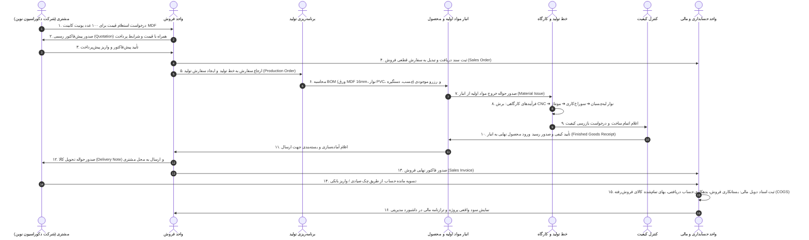

# سناریوی جامع گردش کار عملیاتی (Operational Demo Workflow) — کاردو ERP

**کسب‌وکار نمونه:** صنایع چوب و ام‌دی‌اف آریا (تولیدکننده درب‌های کابینت و یونیت‌های دکوراسیون MDF)  
**رویکرد مهندسی:** اجرای واقعی در پایگاه داده با منطق تجاری ۱۰۰٪ فعال، بدون استفاده از اعداد فیک یا استیت‌های شبیه‌سازی‌شده.

---

## ۱. نقشه جریان پیوسته عملیاتی (End-to-End Workflow Diagram)

---

## ۲. مشخصات موجودیت‌ها در سناریوی MDF (Data Entities)

### ۲.۱ مواد اولیه در انبار (Raw Materials)
1. **ورق MDF واناچای ۱۶ میل سفید صابونی** (واحد: برگ / متر مربع) — قیمت خرید ثبت‌شده در انبار.
2. **نوار لبه PVC ضخامت ۲ میل** (واحد: متر).
3. **چسب گرانول لبه‌چسبان هنکل** (واحد: کیلوگرم).
4. **لولا گازور آرام‌بند کلیپسی** (واحد: عدد).

### ۲.۲ فرمول ساخت (Bill of Materials - BOM)
- **محصول نهایی:** «یونیت کابینت زمینی سایز ۹۰×۶۰ سانتیمتر»
- **ضرایب مصرف در هر یونیت:**
  - ۱.۲۵ برگ ورق MDF.
  - ۸.۵ متر نوار PVC.
  - ۰.۱۵ کیلوگرم چسب.
  - ۴ عدد لولا گازور.
  - ساعت کار مستقیم کارگاهی: ۱.۵ ساعت تکنسین برش و مونتاژ.

### ۲.۳ اسناد مالی دوبل متناظر (Accounting Double-Entry Postings)
1. **خروج مواد از انبار:**
   - بدهکار: حساب کالای در جریان ساخت (Work In Progress - WIP)
   - بستانکار: حساب موجودی مواد اولیه (Raw Materials Inventory)
2. **تکمیل تولید و ورود به انبار محصول:**
   - بدهکار: حساب موجودی کالای ساخته‌شده (Finished Goods)
   - بستانکار: حساب کالای در جریان ساخت (WIP) + دستمزد مستقیم + سربار جذب‌شده
3. **فروش نهایی و تحویل:**
   - بدهکار: حساب بهای تمام‌شده کالای فروش‌رفته (COGS)
   - بستانکار: حساب موجودی کالای ساخته‌شده
   - بدهکار: حساب‌های دریافتنی تجاری (مشتری)
   - بستانکار: درآمد حاصل از فروش + مالیات بر ارزش افزوده
