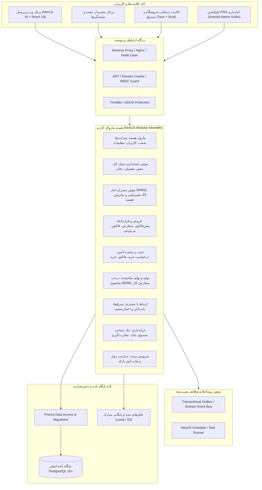

# سند معماری هدف پلتفرم (Target Architecture) — کاردو ERP

این سند معماری بلندمدت و استانداردهای مهندسی کاردو ERP را برای تبدیل شدن به یک سیستم پایدار، امن و در کلاس جهانی تبیین می‌کند.

---

## ۱. نمای کلی سیستم و نمودار معماری (System Topology)

---

## ۲. اصول یکپارچگی داده و تراکنش‌ها (Data Integrity Principles)

1. **انزوای مالی و انبارداری (Transactional ACID Boundaries):**
   هرگونه عملیات تأثیرگذار بر موجودی انبار یا تراز مالی باید درون یک تراکنش تعهدشده (`$transaction`) پایگاه‌داده اجرا شود. در صورت بروز هرگونه خطا در زنجیره، کل سند به وضعیت قبل بازمی‌گردد.
2. **الگوی ثبت تغییرناپذیر (Immutable Event Ledger):**
   هیچ سطری در کاردکس انبار (`InventoryLog`) یا اسناد حسابداری نهایی‌شده قابل به‌روزرسانی (Update) مستقیم نیست. اصلاح اشتباهات حسابداری یا انبارداری صرفاً از طریق صدور **سند اصلاحی یا سند معکوس (Reversal Document)** انجام می‌شود.
3. **پشتیبانی کامل از واحد پولی رسمی (تومان/ریال):**
   تمامی مبالغ مالی در پایگاه داده با دقت اعشاری (`Decimal`) ذخیره شده و نمایش‌ها در سراسر رابط کاربری با فرمت شفاف **تومان** با امکان مشاهده ریز ریالی انجام می‌پذیرد.
4. **طراحی چندشرکتی و چندشعبه‌ای (Multi-Company & Multi-Branch):**
   تمامی اسناد، فاکتورها، حساب‌ها و انبارها به یک شناسه شرکت (`CompanyId`) و شعبه (`BranchId`) متصل هستند تا سیستم توان مدیریت چند هلدینگ یا شرکت زیرمجموعه را داشته باشد.
